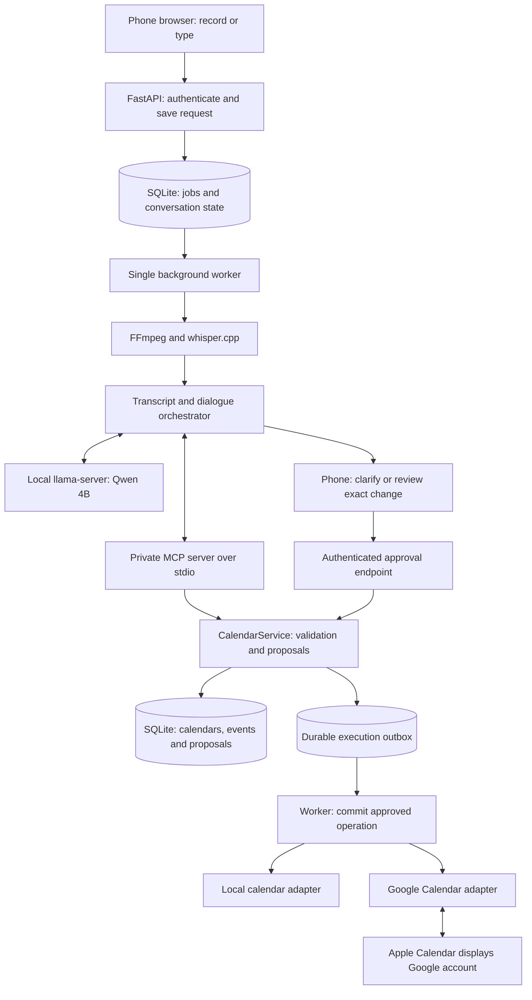

# Version 1 architecture — voice to calendar tools

**Date:** 20 October 2026  
**Status:** Original implementation proposal. See [implemented architecture](architecture.md) for current code boundaries and local-time tool contracts.

## Scope and assumptions

Build the bridge between a phone recording, a local language model, and calendar CRUD. Support manual calendar editing through the same application services used by the voice interface.

- **In scope:** Record/upload, transcribe, clarify, list/search/create/update/delete events, create calendars, show day/week views, review changes, and synchronize with a selected calendar provider.
- **Deferred:** Finding optimal slots, automatic rescheduling, long-term goal decomposition, habit balancing, daily planning notifications, and progress analytics. Existing product requirements remain recorded in the README; they are not prerequisites for this slice.
- **Development assumption:** Run on the available MacBook/Mac locally. No dedicated Mac mini is assumed to have been purchased.
- **Deployment assumption:** Interpret “DigitalOcean AGP” as the previously discussed **8 GB / 4 vCPU CPU-only Droplet**, not a GPU instance. Hosting work is shelved; this is a portability target, not authorization to provision.
- **Privacy:** During development, models, audio, conversations, and database stay on the development machine. A future cloud deployment needs a separate data-location decision. Only explicitly selected calendar fields leave through calendar synchronization.

## Recommended stack

| Responsibility | Selection | Reason |
| --- | --- | --- |
| Mobile web UI | React + TypeScript + Vite | Recording, conversation, proposal review, and editable calendar in one responsive interface. |
| Calendar display | FullCalendar standard day/time grid and interaction plugins | Existing day/week rendering and selection/drag interaction; use standard MIT-licensed features. |
| API and domain services | Python 3.12 + FastAPI + Pydantic | Typed requests and tool schemas, with one validation path for voice and manual edits. |
| Persistence | SQLite, SQLAlchemy, Alembic | Local storage, migrations, conversations, jobs, proposals, and synchronization records. |
| Audio normalization | FFmpeg | Convert browser audio formats to mono 16 kHz, 16-bit PCM WAV. |
| Speech recognition | Whisper `small.en` using `whisper.cpp` | Local English transcription on Apple Silicon and Linux CPU; `base.en` is the speed fallback. |
| Language model | **Qwen3-4B-Instruct-2507**, GGUF **Q4_K_M** | Initial compact, non-thinking instruction model with tool-use capability. |
| Language-model runtime | `llama.cpp` / `llama-server` | Same inference API across native Metal on Mac and CPU-only Linux. |
| Tool protocol | Official Python MCP SDK, local **stdio** transport | A small private tool adapter; no separate public MCP endpoint. |
| Calendar provider | Local adapter first; Google Calendar adapter next | Exercise all CRUD locally, then show Google-backed events in Apple Calendar. |
| Background processing | One durable SQLite-backed worker | Avoid blocking HTTP requests or losing uploads on restart; no Redis/Celery required initially. |

The chosen LLM is a baseline to test, not a claim that it is the latest or best model. Freeze the runtime version, original model revision, GGUF checksum, and chat template after the compatibility tests pass. A downloaded quantization is a separate artifact from Qwen's original weights; record its provenance or convert/quantize the original weights reproducibly.

### Model configuration and resource envelope

- Start with a **4,096-token total context window**, including system instructions, tool schemas, messages, results, and output. Retrieve only relevant calendar windows; keep dialogue fields in the database rather than replaying an unbounded chat history.
- Bound each response to about **512 output tokens** initially; measure actual tool-schema/context needs before expanding limits. Do not enable the model's advertised maximum context on an 8 GB machine.
- Use native tool calling with a verified tool-aware chat template. If template parsing is unreliable, use the same model to generate a constrained JSON action envelope, validate it, and dispatch the same tool registry. This fallback does not execute arbitrary text or code.
- Use one AI job at a time. Run transcription as a subprocess, release its memory, then run the LLM/tool loop. Keep the LLM resident where the measured memory budget allows.
- On Apple Silicon, run inference binaries natively for Metal access. Keep application code portable; do not make Docker Desktop GPU access a requirement. A later Linux deployment can use containers or system services.
- Measure peak resident memory and end-to-end delay on the exact artifacts. If memory or comprehension is inadequate, compare a larger host/model rather than silently falling back to cloud AI.

`whisper.cpp` lists the small model at approximately 466 MiB on disk and 852 MB of runtime memory; this is a reference, not the memory budget of the whole application. The LLM additionally needs weights, context cache, buffers, OS, and application memory.

## Pipeline and process boundaries



This is one application with separate execution roles, not a distributed microservice platform. The API, worker, MCP subprocess, and model server run on the same machine. The worker hosts the MCP client and starts the MCP server using stdio. The model itself neither connects to MCP nor executes tools.

Both the website and MCP adapter call the same `CalendarService` library. They do not maintain different implementations of date handling, permission checks, or CRUD rules. SQLite uses WAL, short transactions, busy timeouts, and job leases; inference and provider requests never hold a database write transaction open.

## Request lifecycle

### 1. Capture and normalize

The browser records a clip using supported browser media APIs and uploads it with a stable client request ID, conversation ID, capture timestamp, and IANA timezone. Start with clips up to two minutes and a configurable upload-size limit. Inspect the decoded duration; do not trust only the filename or declared MIME type.

FastAPI writes the recording into a private temporary directory, creates a durable job, and returns `202 Accepted` plus a job ID. The phone polls status initially; server-sent updates can be added if needed. Typed messages enter the same workflow without transcription.

The worker converts the recording to a supported WAV format and invokes the speech model. Detect empty/silent inputs and ask the user to retry instead of deriving a calendar operation from them. Show the transcript with a correction option. Do not treat a speech confidence value as proof that a date/name is correct.

Delete raw and normalized audio after a transcript has been durably saved. Failed jobs can retain temporary audio for at most 24 hours for retry, followed by cleanup; this is a proposed configurable policy. Delete browser-side temporary recordings after acknowledged upload. No permanent audio archive is required.

### 2. Interpret and clarify

Build a bounded model request containing:

- The user's transcript/message and relevant conversation fields.
- Server-controlled current time, captured time, and timezone.
- Available calendar tools and their schemas.
- Relevant recent tool results; calendar titles/descriptions are data, not instructions.

Persist missing fields and target selection outside the prompt. “Dinner tomorrow” remains incomplete until time and approximate duration are known. “Move it to eight” refers to the active draft only if that reference is unambiguous; otherwise ask.

Resolve relative dates against the original utterance's capture context. Store the resolved date in the draft so a follow-up after midnight does not silently change “tomorrow.” A correction that changes the date/time creates a new draft/proposal revision.

The orchestrator accepts a clarification request, a typed tool call, or a final answer. Give it a bounded loop, initially six tool calls per turn, with capped result sizes and at most one schema-repair attempt. Missing details lead to a question, not repeated guessing.

### 3. Invoke reads or stage a change

The model returns a tool name and structured arguments. The orchestrator checks that tool against the registry and submits the validated call through the MCP client. MCP exposes the operation but does not replace domain validation.

Read tools return relevant calendar records with stable IDs and versions. Mutation tools create an immutable **proposal** describing an exact before/after change. They do not modify provider events immediately.

### 4. Accept and execute

The phone shows the actual title, date, start/end, timezone, calendar, location, and any deletion/update diff. The user accepts or edits it. A UI edit invalidates the old proposal and creates a new revision.

Acceptance goes directly to an authenticated API endpoint; the LLM cannot approve its own proposal or supply an approval token. The backend rechecks target version, permissions, and overlap, then queues the exact approved operation. If the state changed, return a revised proposal or conflict, not a silently different write.

The executor commits via the selected adapter and records the result. User-facing success comes from structured execution state, not from an LLM saying “done.” Provider timeouts produce a pending/reconciling state until the remote outcome is checked.

This follows the existing product decision to let the user accept/reject changes. A future auto-accept policy can use the same service, but it is not required for this version.

## Calendar operations and MCP tools

Implement full event CRUD in `CalendarService`. Use deliberately named proposal tools for writes so their effect is unambiguous.

| Tool | Inputs, summarized | Result |
| --- | --- | --- |
| `calendar_list` | None, except pagination if needed | Calendars, IDs, timezone, provider, and permissions. |
| `calendar_propose_create` | Name, timezone, adapter/provider | Proposed calendar creation. |
| `calendar_propose_update` | Calendar ID, expected version, allowed metadata patch | Proposed name/timezone change where supported. |
| `calendar_propose_delete` | Calendar ID, expected version | Preview including affected-event count; deletion only for app-created calendars in V1. |
| `event_list` | Calendar IDs, bounded start/end range, optional text filter | Matching events, IDs, dates, and versions. |
| `event_get` | Event ID | One complete event record. |
| `event_propose_create` | Calendar ID, title, start, duration/end, timezone, optional location | Validated proposed event or missing-field/conflict result. |
| `event_propose_update` | Event ID, expected version, allowed field patch | Exact before/after proposal. |
| `event_propose_delete` | Event ID, expected version | Exact event deletion preview. |

For V1, calendar collection deletion is limited to app-created calendars, while individual event changes can target selected writable calendars. This prevents an experiment from deleting a pre-existing account calendar. No bulk event deletion or account removal is exposed. Calendar deletion requires an explicit UI preview of the affected items.

All tools use schemas generated from the same Pydantic domain types. A tool returns structured status such as `ok`, `needs_clarification`, `ambiguous_target`, `conflict`, `stale_version`, `not_found`, or `permission_denied`. Include actual missing field names or candidate IDs so the next question is focused.

`approve_proposal` and provider credentials are not exposed as LLM tools. The provider mutation methods are available only to the trusted execution path. No shell, arbitrary HTTP, SQL, or filesystem tool is needed by this assistant.

### Example tool call

After the user has specified “Dinner with Sam tomorrow at 7 p.m., about an hour,” captured on 20 October 2026 in Singapore:

```json
{
  "name": "event_propose_create",
  "arguments": {
    "calendar_id": "cal_personal",
    "title": "Dinner with Sam",
    "start": "2026-10-21T19:00:00+08:00",
    "duration_minutes": 60,
    "duration_is_estimate": true,
    "timezone": "Asia/Singapore"
  }
}
```

The service computes the end time, checks overlap, and returns a proposal ID and revision. The authenticated user's acceptance executes that proposal. A system-supplied request/idempotency key accompanies dispatch; it is not generated by the model.

## Calendar model, time rules, and synchronization

### Data model

| Record | Minimum information |
| --- | --- |
| `Calendar` | Local ID, name, timezone, adapter, provider ID, permissions, app-created flag. |
| `Event` | Local ID, calendar ID, title, start/end UTC, IANA timezone, location, estimated-duration flag, local version, deletion state. |
| `Conversation` / `Message` | Capture context, transcript/text, structured draft, missing fields, selected event IDs, turn state. |
| `Proposal` | Operation, immutable payload, before/after, target versions, revision, approval/rejection/expiry state. |
| `Job` | Input reference, type, state, attempt count, lease, last error; supports restart recovery. |
| `Execution` / outbox | Approved proposal revision, stable operation key, adapter state, retries, confirmed result. |
| `ProviderBinding` | Local/provider IDs, observed provider fields, etag/version, sync cursor where applicable. |
| `ChangeRecord` | Before/after snapshots, source request, execution outcome; excludes secrets/audio. |

The SQLite database is authoritative for conversations, proposals, approvals, and local-only events. For provider-backed calendars, keep desired approved changes separate from last-observed provider state; Google remains authoritative for what is actually published. A pending local change must not be mistaken for a synchronized event.

### Deterministic calendar rules

- Store instants in UTC and preserve the IANA timezone for display and future calendar semantics. Initial user timezone: `Asia/Singapore`.
- Require an explicit start and a positive duration/end. Reject nonexistent or ambiguous daylight-saving local times until resolved. Do not invent an appointment time.
- Use half-open intervals: two events overlap when `a.start < b.end` and `b.start < a.end`. Adjacent events do not overlap. For an update, exclude that same event from its conflict check.
- Check all selected availability calendars, not just the destination calendar. Query fresh provider state before committing when connected. If it cannot be checked, leave the write pending or state the limitation rather than claiming it is conflict-free.
- Ask about overlaps; do not move neighboring events automatically. Conflict resolution in V1 means choosing a different time or explicitly accepting an overlap in the UI.
- “Delete dinner on Friday” first resolves a concrete event ID. Multiple matches require selection. Model-generated IDs must exist and be accessible.
- First-release writes cover single timed events. Display all-day/recurring provider entries as busy where appropriate, but require clarification for recurring-series mutations; do not accidentally update/delete an entire series.
- Ignore cancelled and provider-marked free events for busy checks. Include all-day busy events using the calendar's timezone and end-exclusive dates.
- Do not infer actual completion from an elapsed calendar block. Completion tracking stays deferred.

### Provider adapters

Define provider-neutral operations: list/create/update/delete calendars where supported, and list/get/create/update/delete events. Capabilities differ by provider and should be declared, not assumed.

1. **Local adapter:** Persist calendars/events entirely in SQLite, fully usable without Google credentials or an internet connection.
2. **Google adapter:** OAuth credentials stored outside model context, minimal exported event fields, and a selected Google calendar. Apple Calendar displays the same Google account; do not duplicate events into iCloud.
3. **Future iCloud adapter:** Separate decision if existing iCloud-only events must be included. Apple Calendar display via Google does not implement iCloud read/write access.

Use conditional updates/deletes against provider etags. If an event was edited on the phone after the preview, return a stale-version conflict. Use a stable, provider-valid client event ID for retried Google creates; reconcile after an uncertain response instead of creating a duplicate.

Persist approved intent and the execution outbox transactionally before provider I/O. Mark synchronization confirmed only after a verified provider result. Retry transient errors with bounded backoff; surface authorization failures for reconnection. Manual website edits go through this same path.

If calendar creation cannot use a provider-supplied idempotency mechanism, do not blindly retry an uncertain create; reconcile or request review first. Local deletion uses a tombstone; provider deletion and audit/history retention are separate concerns.

## API and UI contract

Representative routes, to be finalized with the implementation:

| Route | Purpose |
| --- | --- |
| `POST /recordings` | Upload clip; return durable job ID. |
| `GET /jobs/{id}` | Processing state, transcript, clarification, proposal, or error. |
| `POST /conversations/{id}/messages` | Typed clarification or request; recording jobs can reference the same conversation. |
| `GET /calendars` | Available calendars and permissions. |
| `GET /events?start=...&end=...` | Bounded local/provider-backed calendar view with sync state. |
| `POST /proposals` | Manual create/update/delete using the same domain validation. |
| `POST /proposals/{id}/approve` | Approve one exact proposal revision; duplicate submissions are idempotent. |
| `POST /proposals/{id}/reject` | Reject without applying a calendar change. |
| `GET /executions/{id}` | Distinguish queued, syncing, confirmed, conflict, and failed outcomes. |

The mobile screen needs a record button, transcript/conversation panel, day/week view, and change preview with Accept/Edit/Cancel. Dragging a block proposes a new time; it does not bypass the validation/commit path. A typed-input path is useful for debugging and for occasions when voice recording fails.

Start with single-user authenticated sessions, no public signup, same-origin API, and CSRF protection for cookie-authenticated mutations. Expose only the application web entry point; inference endpoints stay on loopback/private interfaces and MCP stays on stdio. Phone microphone access needs trusted HTTPS when accessing the Mac over the network. Keep tokens and private data out of source control and routine logs.

## Suggested repository layout

```text
frontend/                    # React recorder, dialogue, calendar, proposal UI
backend/jarvis/
  api/                       # HTTP schemas, authentication, routes
  domain/                    # Event/calendar/proposal rules and types
  services/                  # CalendarService and proposal execution
  agent/                     # Bounded dialogue loop and tool registry
  mcp/                       # Thin stdio tool adapter
  inference/                 # llama-server client, whisper/FFmpeg wrappers
  calendars/                 # Local and Google adapters
  storage/                   # SQLAlchemy models and repositories
  worker/                    # Durable jobs, leases, retries and outbox
backend/migrations/
tests/                       # Domain, integration and model evaluation fixtures
models/                      # Ignored model artifacts plus provenance manifest
data/                        # Ignored SQLite database and private temporary audio
docs/
```

## Implementation sequence and meaningful checks

1. **Calendar core:** Build local calendar/event CRUD, deterministic time/overlap validation, proposals, and manual UI. Verify adjacent intervals, timezones, invalid durations, stale edits, and ambiguous deletion targets.
2. **Text to tool:** Connect the selected model and MCP tools using typed requests first. Verify actual model/runtime/template compatibility, multi-turn clarification, exact tool arguments, bounded loop behavior, and that no write happens without approval.
3. **Voice input:** Add recording, normalization, transcription, corrections, and persistent job recovery. Test phone-produced audio formats, silence, interrupted uploads, and duplicate submissions.
4. **External calendar:** Add a separate Google test calendar, conditional writes, sync reconciliation, duplicate-safe retries, and visibility in Apple Calendar. Verify changes made on the phone are not overwritten by a stale proposal.
5. **Resource check:** Benchmark the same short notes and event requests on the Mac and later the 8 GB CPU target. Record transcription accuracy, tool-selection/argument accuracy, clarification behavior, peak memory, and time to preview separately from sync latency.

Suggested evaluation cases: “Dinner tomorrow” with missing time/duration; “Move my dinner with Sam to eight”; “Delete Friday's dentist appointment” with two matches; an event overlapping work; a timezone change; a follow-up after midnight; a provider timeout after a successful create; a repeated approval; and instruction-like text inside a calendar title.

One known integration risk is that model/tool templates and runtime parsers can disagree. A reported Qwen3-2507 issue in a specific llama.cpp build misrouted tool calls as reasoning output. Treat the pinned model/runtime/template combination as a tested unit, verify the non-thinking behavior, and do not assume a model card guarantees working calls in every runtime release.

## Reserved optimization boundary

Later add a `Planner` service that reads event availability and tasks and returns proposed changes through `CalendarService`. It will use the same validation, review, execution, and provider adapters. No optimizer, goal database, vector database, or long-running autonomous agent is needed to complete the voice-to-CRUD slice.

## Primary references

- [Qwen3-4B-Instruct-2507 model card](https://huggingface.co/Qwen/Qwen3-4B-Instruct-2507): model behavior, license, and agentic use.
- [llama.cpp tool calling](https://github.com/ggml-org/llama.cpp/blob/master/docs/function-calling.md) and [server API](https://github.com/ggml-org/llama.cpp/blob/master/tools/server/README.md): templates, tool calls, structured output.
- [Reported Qwen3-2507 tool-parser issue](https://github.com/ggml-org/llama.cpp/issues/20809): compatibility example, not a claim that every current release is affected.
- [whisper.cpp](https://github.com/ggml-org/whisper.cpp): local inference, audio normalization, model sizes, CPU and Apple acceleration.
- [Official Python MCP SDK](https://github.com/modelcontextprotocol/python-sdk): client/server and stdio transport.
- [FastAPI](https://fastapi.tiangolo.com/) and [FullCalendar licensing](https://fullcalendar.io/license).
- [Google event creation](https://developers.google.com/workspace/calendar/api/guides/create-events), [conditional modifications](https://developers.google.com/workspace/calendar/api/guides/version-resources), and [sync](https://developers.google.com/workspace/calendar/api/guides/sync).
- [Google events in Apple Calendar](https://support.google.com/calendar/answer/99358?hl=en).
