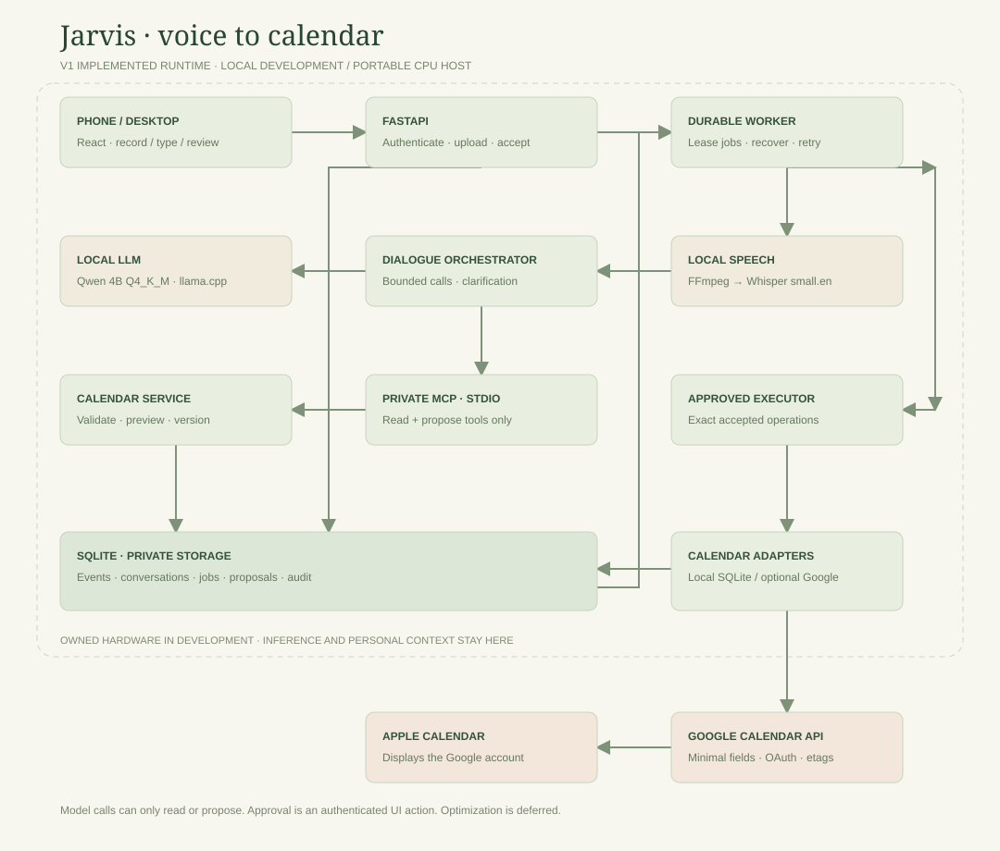

# Implemented V1 architecture

The implemented application is a single-user voice-to-calendar bridge. Optimization, long-term goal routines, recurring-event mutations, and proactive planning notifications remain deferred.

The editable [Mermaid source](architecture/runtime.mmd) accompanies this diagram. The SVG is generated by `python scripts/render_architecture.py` without external services.

## Runtime boundaries

| Process | Code | Responsibility |
| --- | --- | --- |
| Web UI | `frontend/src/App.tsx` | Recording, typed conversation, local-time day/week view, manual CRUD, exact proposal review. |
| HTTP API | `backend/jarvis/api.py` | Bearer authentication, same-origin writes, bounded uploads, durable capture jobs, authenticated acceptance. |
| Worker | `backend/jarvis/worker.py` | Serial processing, job leases/recovery, transcription, dialogue, approved execution, sync retries, audio cleanup. |
| Speech subprocess | `backend/jarvis/audio.py` | FFmpeg converts browser audio to mono PCM; whisper.cpp small.en transcribes locally. |
| Model server | llama.cpp 0.7.0, build b11669 | Qwen3-4B-Instruct-2507 Q4_K_M; 4,096-token context, one slot, deterministic decoding. |
| Dialogue/MCP client | `backend/jarvis/agent.py` | Bounded tool loop, relevant history, authoritative calendar IDs, verified proposal state. |
| MCP subprocess | `backend/jarvis/mcp_server.py` | Private stdio tools backed by the same calendar domain service. No approve/execute capability. |
| Calendar domain | `backend/jarvis/calendar.py` | Validate times and targets, overlap checks, immutable proposals, version checks, local transactions, audit. |
| Provider integration | `backend/jarvis/google.py` | Explicit OAuth connection to one Google calendar, bounded refresh, conditional writes, timeout reconciliation. |

The API, worker, and MCP subprocess share one SQLite database using WAL and short serialized write transactions. Inference and network calls occur outside database transactions. There is no Redis, external database, hosted AI API, or autonomous optimization loop.

## Voice and text path

1. An authenticated phone/desktop browser uploads audio or submits text with a stable request ID. Audio capture requires localhost or trusted HTTPS.
2. The API saves a durable job and a conversation capture context. Duplicate request IDs are accepted only for the same input.
3. The worker normalizes and transcribes audio. The transcript is saved before raw audio is deleted. Failed audio inputs expire after 24 hours.
4. The dialogue orchestrator supplies timezone, capture context, exact calendar IDs, relevant history, and typed tools to the model.
5. The model requests calendar reads or a proposed mutation through the MCP client. It cannot approve its own proposal.
6. The service checks schema, time, permission, event identity/version, and overlap, then persists a preview.
7. The UI presents the exact operation for acceptance, cancellation, or correction. An explicit UI checkbox is required to accept a known overlap.
8. Acceptance creates one durable execution job. The worker commits locally or through Google, then records the actual outcome. The UI distinguishes pending/queued, confirmed, conflict, failed, and uncertain provider outcomes.

## Local-time tool design

The model is not asked to calculate UTC offsets. Write tools accept a local `date`, local `time`, IANA `timezone`, and duration. List tools accept a local date and number of days. Application code calculates UTC instants, search intervals, and daylight-saving validity. Read-tool results expose local date/time and duration to reduce conversion mistakes.

The HTTP/manual editor still accepts explicit-offset timestamps and validates them against the named timezone. SQLite stores UTC instants and preserves the timezone. DST gaps and unclarified folds are rejected. Overlap checks use half-open intervals and include busy events from all locally selected calendars.

MCP tools: `calendar_list`, `event_list`, `event_get`, and `calendar_propose_*` / `event_propose_*` for creation, update, and deletion. Calendar collection deletion is limited to app-created local calendars and previews affected events. Recurring and all-day provider events contribute availability but are view-only for V1 writes.

## Consistency and privacy

- SQLite is authoritative for local events, conversations, proposals, and approvals. Google is authoritative for published provider state.
- A source capture job can stage only one proposal, so recovering an interrupted turn cannot create a second proposal for the same request.
- Duplicate acceptance and local execution are idempotent. Event versions prevent stale UI previews from overwriting later edits.
- Google creates use a stable provider-valid event ID. A timeout is reconciled against that ID before another write; updates/deletes use etags.
- The provider refreshes the requested operation's time window before execution. Provider edits on the phone invalidate stale local previews.
- Retryable provider errors use bounded backoff. An unresolved outcome is marked uncertain and must be reconciled using the original operation, not a fresh create.
- Only selected title, timing, and location fields are exported. Transcripts, conversations, and private context are excluded from provider event bodies.
- Tokens, audio, models, and the database are ignored by Git. OAuth credentials are written to a private local file. The LLM never receives them.
- Production has a same-origin frontend/API; the development proxy preserves the browser Host header for origin checks. Inference is private and MCP uses stdio.

## Tests and delivery

Backend tests cover timezones/DST, interval conflicts, stale previews, concurrent/duplicate approval, calendar CRUD, source-job idempotency, auth/origin/upload boundaries, worker recovery, real stdio MCP, and mocked Google edits/timeouts. Browser tests exercise the actual API and worker on desktop and phone viewports. Model evaluation runs separately against local weights; CI does not download models or use real calendar credentials.

GitHub Actions runs Python checks, frontend tests/build, desktop/mobile browser tests, migration checks, and a Linux container build/smoke test. The manual release workflow reruns those checks before publishing a versioned container to GHCR. Server deployment is deferred while hosting is shelved.

See [development setup](development.md), [CI/CD](ci-cd.md), [original design proposal](architecture-v1.md), and [product roadmap](product-plan.md). This diagram documents the runtime actually implemented; the original proposal records earlier tradeoffs.
